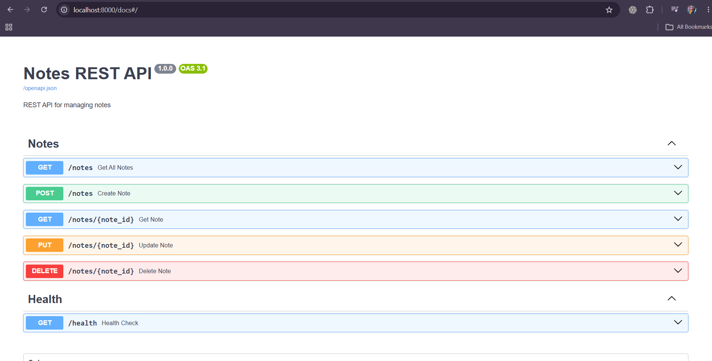
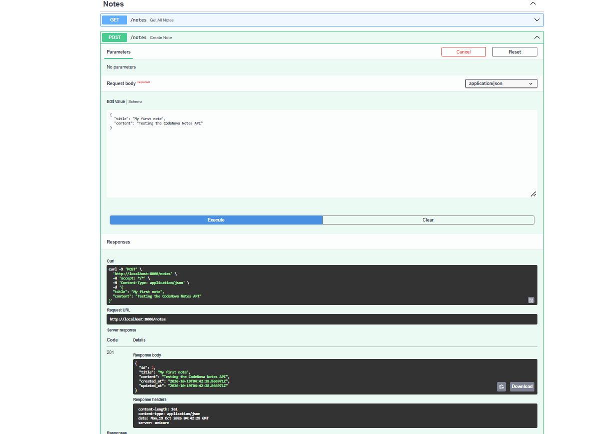
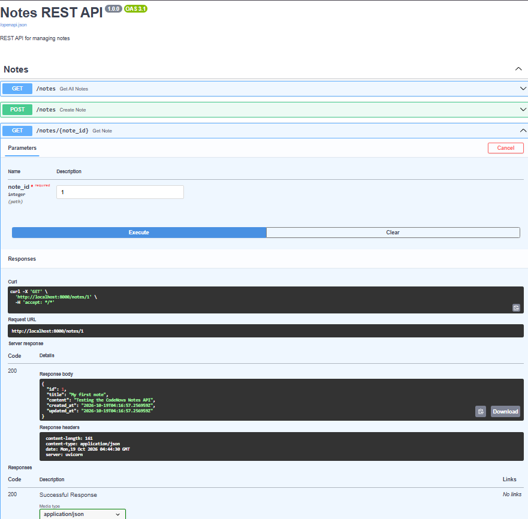
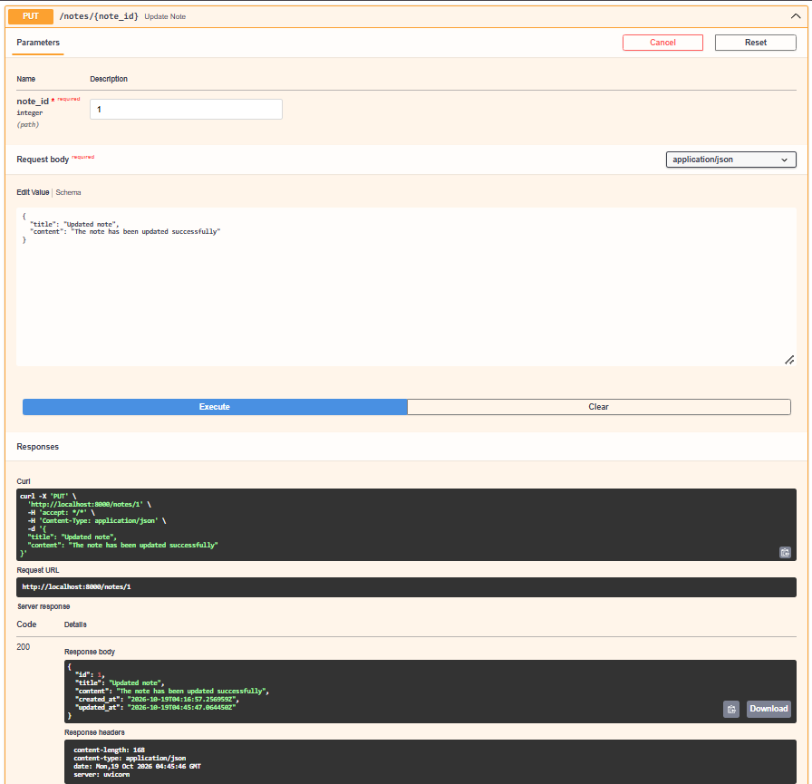
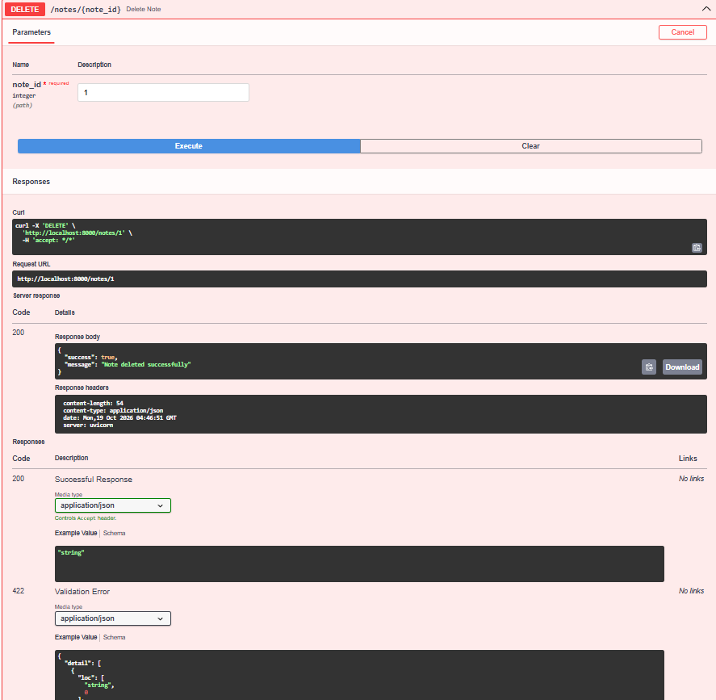
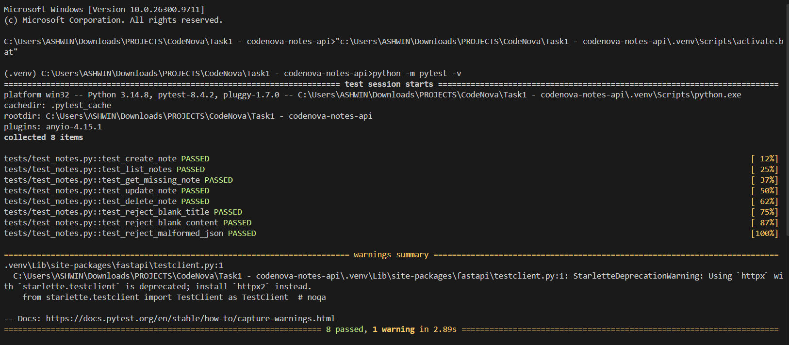

# Notes REST API

A RESTful API built with Python and FastAPI to create, retrieve, update, and delete notes. This project was developed as part of the CodeNova Backend Development Internship — Task 1.

## Features

- Create, retrieve, list, update, and delete notes.
- Persistent storage using SQLite.
- Request validation for note titles and content.
- Standardized JSON error responses.
- Appropriate HTTP status codes.
- Automatic API documentation using Swagger UI.
- Automated API tests using Pytest.
- Parameterized SQL queries to help prevent SQL injection.

## Tech Stack

- **Language:** Python
- **Backend Framework:** FastAPI
- **Database:** SQLite
- **Data Validation:** Pydantic
- **API Testing:** Pytest and FastAPI TestClient
- **API Documentation:** OpenAPI / Swagger UI

## Project Structure

```text
Task1 - codenova-notes-api/
├── app/
│   ├── controllers/
│   │   └── note_controller.py
│   ├── models/
│   │   └── note.py
│   ├── routers/
│   │   └── notes.py
│   ├── schemas/
│   │   └── note.py
│   ├── database.py
│   ├── errors.py
│   └── main.py
├── tests/
│   └── test_notes.py
├── postman/
│   └── notes-api.postman_collection.json
├── screenshots/
├── .gitignore
├── requirements.txt
└── README.md
```

## Installation and Setup

### 1. Clone the repository

```bash
git clone https://github.com/Ashwin-2008/Task1---codenova-notes-api.git
cd Task1---codenova-notes-api
```

### 2. Create a virtual environment

```bash
python -m venv .venv
```

### 3. Activate the virtual environment

**Windows PowerShell:**

```powershell
.venv\Scripts\Activate.ps1
```

### 4. Install dependencies

```bash
python -m pip install -r requirements.txt
```

### 5. Start the application

```bash
python -m uvicorn app.main:app --reload
```

The API will run at:

`http://127.0.0.1:8000`

## API Documentation

Once the server is running, access the automatically generated documentation:

- **Swagger UI:** http://127.0.0.1:8000/docs
- **OpenAPI JSON:** http://127.0.0.1:8000/openapi.json
- **Health Check:** http://127.0.0.1:8000/health

## API Endpoints

| HTTP Method | Endpoint | Description | Success Status |
|---|---|---|---|
| GET | `/notes` | Retrieve all notes | 200 OK |
| GET | `/notes/{note_id}` | Retrieve a note by ID | 200 OK |
| POST | `/notes` | Create a new note | 201 Created |
| PUT | `/notes/{note_id}` | Update an existing note | 200 OK |
| DELETE | `/notes/{note_id}` | Delete a note | 200 OK |

## Request and Response Examples

### Create a note

**Request**

```http
POST /notes
Content-Type: application/json
```

```json
{
  "title": "My First Note",
  "content": "This is my first note."
}
```

**Successful response:** `201 Created`

```json
{
  "id": 1,
  "title": "My First Note",
  "content": "This is my first note.",
  "created_at": "2026-10-19T04:00:00+00:00",
  "updated_at": "2026-10-19T04:00:00+00:00"
}
```

*The ID and timestamps above are illustrative; actual values are generated by the application.*

### Retrieve all notes

```http
GET /notes
```

Returns a JSON array containing the saved notes.

### Retrieve a note by ID

```http
GET /notes/1
```

Returns the requested note if it exists. Otherwise, returns `404 Not Found`.

### Update a note

```http
PUT /notes/1
Content-Type: application/json
```

```json
{
  "title": "Updated Note",
  "content": "The note has been updated."
}
```

Returns the updated note with `200 OK`.

### Delete a note

```http
DELETE /notes/1
```

Returns a success message when the note is deleted. If the ID does not exist, returns `404 Not Found`.

## Validation and Error Handling

- Title must not be empty or contain only whitespace.
- Title length must not exceed 200 characters.
- Content must not be empty or contain only whitespace.
- Content length must not exceed 10,000 characters.
- Malformed JSON and invalid request data return `400 Bad Request`.
- Requests for nonexistent notes return `404 Not Found`.
- Unexpected server errors return `500 Internal Server Error`.
- Error responses follow a consistent JSON structure.

Example error response:

```json
{
  "success": false,
  "error": {
    "code": 404,
    "message": "Note not found",
    "details": []
  }
}
```

## Automated Testing

Run the automated test suite from the project root:

```bash
python -m pytest -v
```

The test suite covers:

- Note creation.
- Listing notes.
- Handling nonexistent note IDs.
- Updating notes.
- Deleting notes.
- Rejecting blank titles.
- Rejecting blank content.
- Rejecting malformed JSON.

**Local test result:** 8 tests passed.

## Screenshots

The following screenshots demonstrate API execution and automated testing.

### 1. API Documentation



### 2. Create Note



### 3. Retrieve Notes



### 4. Update Note



### 5. Delete Note



### 6. Automated Tests



## API Testing Collection

The Postman collection is available at:

`postman/notes-api.postman_collection.json`

Import this file into Postman to test the CRUD endpoints.

## Internship Information

- **Program:** CodeNova Backend Development Internship
- **Task:** Task 1 — Notes REST API
- **Repository:** [codenova-notes-api](https://github.com/Ashwin-2008/Task1---codenova-notes-api)

## License

This project was developed for educational and internship purposes.
